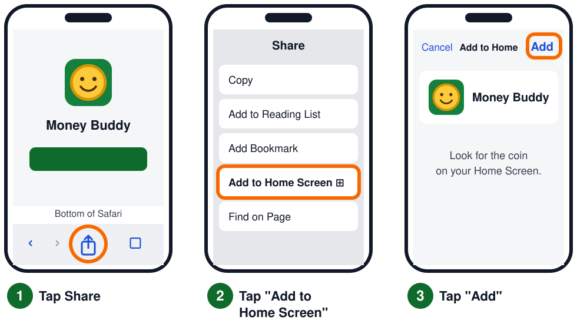
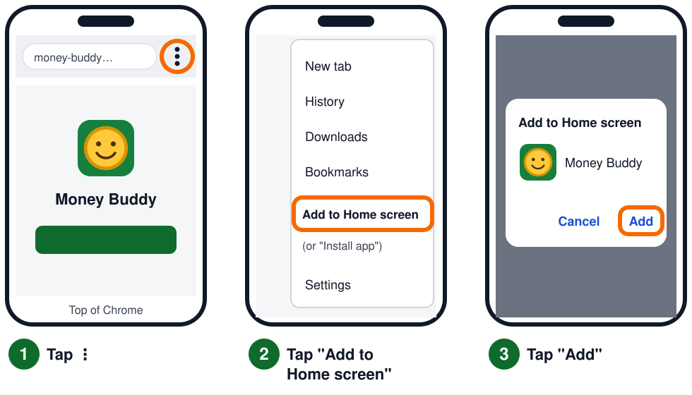

# Money Buddy 🪙

Money Buddy is a simple money app for students in Syracuse University's InclusiveU program.
It helps a student **stop and think before they buy something**, so they still have money for their big plans.

- It uses **big text, pictures, and short words**.
- It can **read the screen out loud** (🔊 Read to me).
- It **warns but never blocks**. The student always makes the final choice.
- It works **without internet** after the first visit.
- **No login and no accounts.** Everything is saved only on the student's phone. Nothing is sent anywhere.

---

## What the student does

1. **Make a plan (only once).** The student enters how much money they have in their bank and on their 'Cuse Cash card. That's it: 3 short steps. After that, the money carries over from month to month.
2. **Add big things any time.** On Home, the student taps **➕ Add a big thing** for things they need to pay for this month (like a concert or laundry). The app keeps that money set aside. **🐷 Savings** is one of the pictures: money put in savings stays set aside every month and grows each time the student adds to it. If the big things cost more than they have, the app says **"Uh oh."** right away.
3. **Before buying something,** they tap **🛒 I want to buy something**, type the price, and pick a picture.
4. **The app checks the price.**
   - ✅ **Fine:** it is saved, and the student sees a happy message.
   - ⚠️ **Yellow "Think first"** or **orange "Be careful":** the price is a big part of their spending money.
   - 🛑 **Red "Stop!":** the purchase would use money set aside for a big thing. The app names what they would lose (for example, "🎟️ Concert").
5. The student taps **✋ I will wait** (and gets a 🌟 and "You didn't spend $X") or **Buy it anyway**. Both choices are okay.

The warnings get stricter as the month goes on, because there is less time left to make the money last.

### Calendar and reminders 📅
- When the student adds a big thing, they can pick **the day they will buy it** (or tap **I don't know**).
- **📅 My calendar** on the Home screen shows the month. Days with a big thing show its picture (✅ once paid). Tap a day to see it, mark it paid, or add a big thing on that day. On small phones, the calendar shows as a **List** of days instead.
- On the day of a big thing, Home asks **"Today: 🎟️ Concert, $60. Did you pay it?"** It also says when one is coming up in the next 3 days, and asks again if a day passes without it being paid. Until it is paid, that money stays saved for it.

### Fixing mistakes ✏️
- **↩️ Oops! Undo:** after buying something, "I got money", "I paid it", or fixing money, a big Undo bar shows at the bottom for 5 seconds, then goes away. If the app is reading out loud, or a finger is on the bar, it waits, and the 5 seconds start again after.
- **✏️ Fix my money** (on each money card): type how much is *really* in the bank or on the 'Cuse Cash card. The app saves the difference, so the list still shows what happened.
- **❌ Remove** on every line in **What I bought** (it asks first).
- **Tap a big thing** on Home to change its amount or day, remove it, or say **Not paid yet** if it was marked paid by mistake.

---

## Put it on the internet for free (GitHub Pages)

You only do this once. It takes about 15 minutes. You do not need to know how to code.

### 1. Make a GitHub account
Go to **[github.com](https://github.com)** and click **Sign up**. A free account is fine.

### 2. Make a new "repository" (a folder for the app)
1. Click the **+** button at the top right, then **New repository**.
2. For **Repository name**, type `money-buddy`.
3. Choose **Public**. (Free GitHub Pages needs this. Only the app's code is public. Student money data stays on their phones.)
4. Click **Create repository**.

### 3. Upload the app files
1. On the new page, click the link **uploading an existing file**.
2. Open the `money-buddy` folder on your computer. Select **everything inside it**: all the files *and* the `icons` and `docs` folders. Drag them into the browser window.
   *Tip: Chrome and Edge let you drag folders. If folders don't upload, upload the files first, then click **Add file → Upload files** again for the `icons` folder.*
3. Wait for the uploads to finish. Then click the green **Commit changes** button.

### 4. Turn on GitHub Pages
1. Click **Settings** (near the top of the repository page).
2. In the left menu, click **Pages**.
3. Under **Build and deployment**, set **Source** to **Deploy from a branch**.
4. Set **Branch** to **main**, and the folder to **/ (root)**. Click **Save**.
5. Wait 1–2 minutes, then refresh the page. You will see: **"Your site is live at `https://YOUR-NAME.github.io/money-buddy/`"**.

That link is the app. Send it to students, or turn it into a QR code to print.

---

## Put it on a phone's Home Screen

Students should do this **before** making their plan. *(On iPhone, the Home Screen app keeps its own saved data, separate from Safari. A plan made in a Safari tab will not show up in the Home Screen app.)*

### iPhone (use **Safari**)



1. Open the app link in **Safari**.
2. Tap the **Share** button (a square with an arrow pointing up ⬆️).
   - On newer iPhones, you may need to tap **⋯** (three dots) at the bottom first, then **Share**.
3. Scroll down and tap **Add to Home Screen**. If you don't see it, tap **View More** or **Edit Actions**.
4. Tap **Add** at the top right.
5. Find the **smiling coin** 🪙 on the Home Screen and open Money Buddy from there.

### Android (use **Chrome**)



1. Open the app link in **Chrome**.
2. Tap **⋮** (three dots) at the top right.
3. Tap **Add to Home screen**. (On some phones it says **Install app**.)
4. Tap **Add** (or **Install**).
5. Find the **smiling coin** 🪙 on the Home Screen and open Money Buddy from there.

---

## Good to know

| Question | Answer |
|---|---|
| **Where is the data saved?** | Only on that one phone, inside the app. It is never sent anywhere. |
| **Can it move to a new phone?** | No. On a new phone, the student makes a new plan. |
| **What erases the data?** | Deleting the app from the Home Screen, or clearing the browser's website data. |
| **Does it need internet?** | Only the first time. After that, it works offline. |
| **What happens on the 1st of the month?** | The first time the app opens, it celebrates ("🎉 You saved $X!" – the money left at the end of last month) and asks **"Did you get money?"**. The money left over and 🐷 Savings carry into the new month. Other big things start fresh: they show up under **➕ Add a big thing** as ideas the student can tap to keep. "What I bought" starts empty. |
| **The 🔊 button is missing.** | That phone or browser can't read out loud. Everything else still works. |
| **It reads alerts out loud by itself.** | That helps students who don't read well. To turn it off, go to **⚙️ Settings**. Students who use VoiceOver or TalkBack should turn it off, so two voices don't talk at once. |

---

## Changing the words

Every word the app shows is in **one file: `copy.js`**.

1. On GitHub, click `copy.js`, then click the ✏️ pencil icon.
2. Change only the words **inside the quotes**. Keep words in `{curly braces}` exactly as they are (the app fills them in, for example `{amount}` → `$20`).
3. Click **Commit changes**.
4. Follow **"After any change"** below.

**`COPY.md`** is an easy-to-read list of every phrase, with a word count to help keep the reading level low. Lines with a sentence over 6 words are marked ⚠️. If you have Node.js, run `node tools/make-copy-md.js` after editing to update the list.

You can change the emojis too. They are at the bottom of `copy.js`, under `icons`.

---

## After any change

Phones keep a saved copy of the app so it works offline. To make phones get your new version:

1. Open **`sw.js`** on GitHub and click ✏️.
2. Find this line near the top:
   ```js
   var CACHE = 'money-buddy-v3';
   ```
   Change the number: `v3` → `v4` (next time, `v5`, and so on).
3. Click **Commit changes**.

Students will get the new version the **second** time they open the app (the first open downloads it quietly).

---

## For developers

- Plain HTML, CSS, and JavaScript. No build step and no dependencies.
- `logic.js` holds all the budgeting math as pure functions. `app.js` holds the screens. `copy.js` holds the words. `storage.js` handles saving (`localStorage` key `moneyBuddy.v2`). `speech.js` handles reading out loud. `sw.js` handles offline use.
- **Saved data versions:** the data has a `version` number (now **2**). When a phone that used version 1 opens the new app, `storage.js` reads the old `moneyBuddy.v1` data, upgrades it with `MBLogic.migrate()` (adds empty `adjustments`, ids for "I got money", and no day on big spends), and saves it as `moneyBuddy.v2`. **The `moneyBuddy.v1` data is never changed or deleted**, so it stays as a backup, and an old cached copy of the app can never write over new data. If you change the data shape again, add a version 2 → 3 step to `migrate()` and a test for it.
- **Tests:** `npm test` (or `node --test tests/logic.test.js tests/storage.test.js`). Uses Node's built-in test runner, Node 18 or newer.
- **Pretend it is another day (testing only):** open `http://localhost:8000/?today=2026-10-25`. This works only on `localhost` / `127.0.0.1`, never on the real site, and a 🧪 tag shows at the top. It changes the calendar, reminders and weekly alert limits. **Careful:** a day in a *different month* starts a new month and archives the current one on that browser, just like a real new month.
- **Run locally:** `python -m http.server 8000` in this folder, then open `http://localhost:8000`. (Opening `index.html` directly works too, but offline mode needs a web server.)
- **Icons:** `node tools/make-icons.js` redraws the PNG and SVG icons.
- If saved data is unreadable, the app starts a fresh plan and keeps a copy of the bad data under `moneyBuddy.v2.broken`.
- **No savings goal:** older versions asked for a save goal. `sanitizeState()` now drops any old `saveGoal`, so that money simply counts as free money. The data version did not change.
- **Savings:** a big spend with `savings: true` – one per source, never dated or paid. `MBLogic.addSavings()` grows it. Big spends saved before this have no `savings` field and load as `false`.
- **New month:** once `setupComplete` is true, `MBLogic.startMonth()` archives the old month, starts each source at the money left over (never below $0), keeps savings pots, and turns the other big spends into suggestions.

### The alert rules

For each money source: **free money** = money you have − big things not yet paid.

| Day of month | Threshold |
|---|---|
| 1–7 | 50% |
| 8–14 | 40% |
| 15–21 | 20% |
| 22–end | 10% |

| Alert | When |
|---|---|
| 🛑 Not enough money | price > all the money in that source |
| 🛑 Stop! | price > free money (it would use big-thing money) |
| ⚠️ Be careful (orange) | price > 2 × threshold × free money |
| ⚠️ Think first (yellow) | price > threshold × free money |
| ✅ Fine | everything else |

In week 1 (50%), "2 × threshold" equals all of the free money, so the orange alert can't happen in week 1. That follows directly from the rules.
